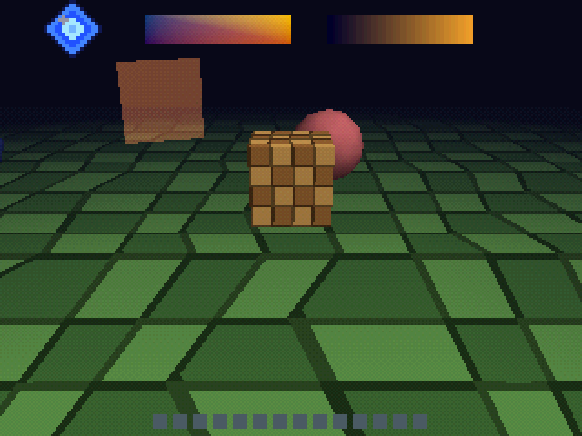
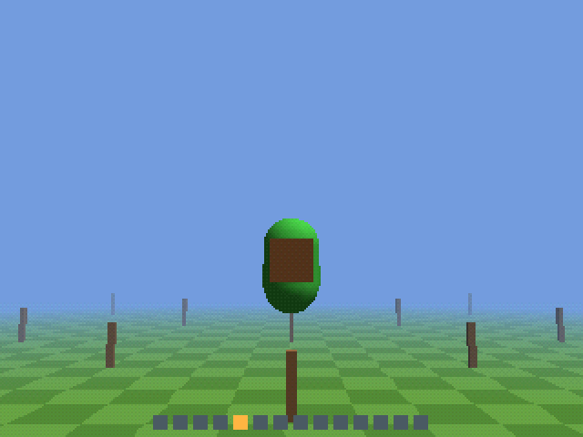
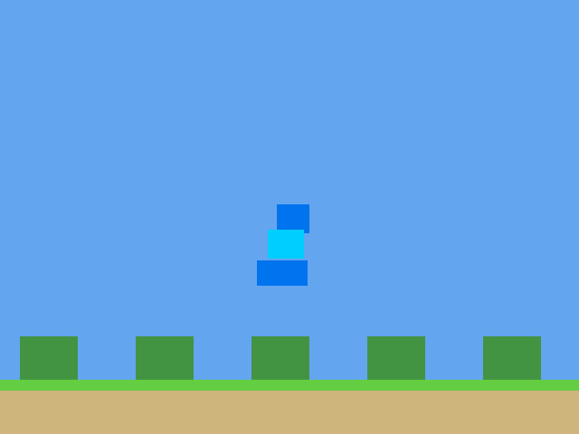

# psx

A toolkit for taking PlayStation games apart and rebuilding them as new Rust games.

The idea: you point it at a PS1 game you own, dig out how it works (how high the player
jumps, what the level data looks like, which sounds play when), and then write the game again
from scratch in [Bevy](https://bevy.org). The result should look and feel like the original,
wobbly textures and all, but the code should read like something written today. It shouldn't be
an emulator in disguise. Someone should be able to open it and start changing things.

It's built to be driven by AI agents as much as by people. Most of what's here exists because an
agent tried to use it and got stuck somewhere.

## What's in the box

- **A PlayStation emulator for investigation.** It isn't for playing games; it's for asking
  questions like "what wrote to this address?", "what did this frame draw?" or "how does this value
  change when I press jump?". It's checked against [PCSX-Redux](https://github.com/grumpycoders/pcsx-redux)
  and real hardware tests, and it gets about 19 PAL games to gameplay so far.
- **Disc and file tools.** Browse a disc, pull out files, and decode movies (STR), XA audio,
  textures (TIM), 3D models (TMD to glTF) and sound banks (VAB/VAG to WAV).
- **Memory detective work.** Cheat-finder-style RAM search, per-frame value logging,
  disassembly and cross-references, and "poke this value and see what happens".
- **A Bevy game template** with the PS1 look built in: vertex wobble, affine textures,
  15-bit colour, dithering where the PS1 dithered, and the PS1's blend modes. Your game code stays plain
  Bevy: entities, components, systems.
- **An MCP server**, so an agent can use all of the above as tools.

## See it in action

This is the template's demo game, out of the box: plain Bevy entities, drawn with the PS1 look.



There are two worked examples, each with a write-up of how it was done. Both use stand-in
graphics on purpose: the point is the rebuilt *mechanics*, and none of the original game's art
goes in the repo.

 

- **Croc:** Croc's movement, traced from RAM back to the code that writes it, then rebuilt as a
  small Bevy demo. [Write-up](research/case-study-croc.md) · [code](examples/croc-movement/README.md)
- **Mega Man 8:** Mega Man's walk and jump, rebuilt in 2D and checked tick by tick against
  the real game. [Write-up](research/case-study-megaman8.md) · [code](examples/megaman8-movement/README.md)

## Getting started

You'll need Rust, your own disc images and a PS1 BIOS dump. **None of those are included, and
none should ever be committed.** Put them here (both folders are git-ignored):

```
media/   your disc images (.cue/.bin)
bios/    BIOS dumps
```

Then try:

```bash
cargo build --release
target/release/psx disc "media/Some Game.cue"
```

To start a new game from the template:

```bash
target/release/psx template create ../my-game
cd ../my-game && cargo run
```

To hook it up to Claude Code:

```bash
claude mcp add psx -- /path/to/psx/target/release/psx --root /path/to/psx mcp
```

## Where to go next

- [README_FOR_AGENTS.md](README_FOR_AGENTS.md): every command and flag, in detail.
- [templates/psx-bevy](templates/psx-bevy/README.md): the game template.
- [research/](research/): notes on the emulator, file formats and case studies.
- [PLAN.md](PLAN.md): where this is headed.

psx has a sibling, [mdx](https://github.com/bombpersons/mdx), which does the same job for the Mega Drive.

## License

MIT or Apache-2.0, at your option.
