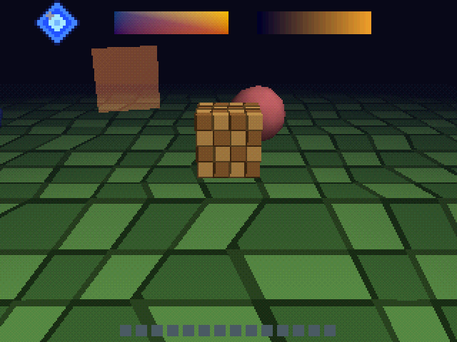

# psx

**Point an AI agent at a PlayStation game. Get back how it works, and a native port that plays the same.**

psx is a PS1 reverse-engineering toolkit built for agents. It hands them an emulator they can
interrogate, disc and asset decoders, Ghidra on tap and a game template with the PS1 look, all as
MCP tools. The agent spends its time on the game, not on fighting the tooling.

Most of what's here exists because an agent tried to use it and got stuck somewhere.

## What an agent can ask

| Question | How psx answers |
|---|---|
| *Which byte is the player's X position?* | Run the same moment holding LEFT, nothing, RIGHT; `ram_search` keeps what moved the right way. |
| *What code writes it?* | `watch` the address: every store, with the instruction that made it. |
| *What does that code do?* | `code_decompile` the writer's PC. Import, analysis and caching are automatic. |
| *How high is the jump, frame by frame?* | `sample` the value into a CSV while replaying the input. |
| *Is my theory right?* | `poke` a value at a chosen frame and compare against an untouched run. |
| *Where did this texture, model or sound come from?* | `gpu_frame`, `assets_scan`, `trace_spu` and `trace_cd` connect screen and speaker back to RAM and the disc file. |
| *Does my rebuild play the same?* | `port_check` replays recordings of the original through the port and gives the first difference. |

## One loop, start to finish

Mega Man 8, from a save state in the first stage. The case study's steps, in today's tool names:

```
runs: LEFT / idle / RIGHT     →  ram_search: x lives at 0x8015E8A8 (16.16 fixed point)
run with watch on the player  →  jump state set at 0x8010F8F0, vy = 5.785 at 0x8010C9C4
disasm + one trace window     →  walk 1.5 px/tick, gravity 0.25, fall speed capped at 6
template + trajectory test    →  a held-out scenario matches all 101 ticks exactly
```

The full story is in the [write-up](research/case-study-megaman8.md).

## Why agents get through it quickly

- **Exact answers.** The emulator reports what really happened: the storing instruction, the CD
  sector, the GPU command, the sound sample. It's checked against
  [Mednafen](https://mednafen.github.io/) and hardware tests, and gets about 19
  PAL games to gameplay so far.
- **Cheap experiments.** Save a checkpoint once, then branch short runs from it with different
  buttons, all inline in one call.
- **Small replies.** Evidence lands in files; calls return paths and counts (`summary`), and
  `read` pages through the rest. All the tool definitions fit in about 18K tokens, and the
  `guide` tool serves recipes when they're needed.
- **One server, many games.** Each Claude Code session works in the game folder it was opened in.
- **Same thing on the command line.** Every tool is a `psx` command printing the same JSON.

## What's in the box

- **An investigation emulator.** Not for playing; for asking "what wrote this?", "what did this
  frame draw?" and "which sound played when?". Save states, input replay, write/read watches,
  per-frame sampling, pokes, instruction traces, GPU frame capture, CD and sound traces.
- **Disc and asset tools.** Browse discs, extract files, decode STR movies, XA audio, TIM
  textures, TMD models (to glTF) and VAB/VAG sound banks (to WAV). Game-specific formats plug in
  through generated [external parsers](docs/external-parsers.md).
- **Memory detective work.** Cheat-finder search, RAM diffs and views, disassembly and
  cross-references, PsyQ library naming.
- **Ghidra.** Pseudocode and callers for any address, from an EXE or a RAM snapshot; rename
  functions and export verified names back into traces.
- **A port template** in plain Rust with no engine, and add-ons when the port wants them: a
  window, a renderer with a PS1 look and a modern one, the disc import on start-up, menus.
  It takes template updates in place.
- **Porting by recordings.** Recordings of the original say what's right and `port check`
  gives the first difference; the agent picks what's next and you point it. See below.

## Porting a game

`psx port init DEST --media GAME.cue` writes a port's workspace: the template, a `goal.toml`
for what you want in your words, a `STATUS.md` the agent keeps, the disc and BIOS linked in,
and psx's MCP server for the agent working there. An ordinary interactive session (Claude
Code, Codex, OpenCode) in the workspace takes one thing at a time: a recording's first
difference, or a piece you asked for. It commits, runs `port_check`, writes down what's next
and why in `STATUS.md`, and stops; the next session starts from there.

psx says what's right: recordings of the original, replayed tick by tick through the port,
compared on what a player could notice. You give direction, and you say when it's done by
playing it: a play the agent asks for becomes a map of what's missing, and plays you list in
`goal.toml`'s `held_out` are judged without the agent seeing them (`psx port status --plain`).
The plan behind this is [docs/simple-port-plan.md](docs/simple-port-plan.md).

## See it in action

The template's demo, out of the box:



One worked example goes through the whole port loop:
[**Croc's movement**](examples/croc-movement/README.md). Croc's running, jump and stomp were
found with coverage diff, recorded from the original, ported until every recording passed
(three of them played by a person and held out from the agent), and reviewed as code for a new
game. It's the workspace as the agent left it, since moved from Bevy to the plain template
with the `full` add-on, with no disc data in it.

## Get started

You need your own disc images and a PS1 BIOS. **Disc images and firmware are not included and
must never be committed**; the local `media/` and `bios/` folders are git-ignored.

Install the latest release (Linux x64/arm64, macOS):

```bash
curl -fsSL https://raw.githubusercontent.com/bombpersons/psx/master/install.sh | sh
```

On Windows (PowerShell):

```powershell
powershell -ExecutionPolicy Bypass -c "irm https://raw.githubusercontent.com/bombpersons/psx/master/install.ps1 | iex"
```

The installer checks the download's SHA-256, puts `psx` in `~/.local/bin` (Windows:
`%LOCALAPPDATA%\psx\bin`, added to your PATH) and fetches the PsyQ signatures `psx code symbols`
uses. Run it again to update. Building from source needs Rust 1.89+:
`cargo install --locked --git https://github.com/bombpersons/psx psx`.

Then add a BIOS, either your own dump or a checksum-verified download of a known image (pick the
region of your games):

```bash
psx bios install --from /path/to/bios.bin
psx bios install --download --region pal    # or ntsc-u, ntsc-j
```

Nothing ever downloads on its own; `psx context` shows what is installed and the download
catalog. See [BIOS setup](docs/bios-setup.md).

Hook it into Claude Code once, for every project:

```bash
claude mcp add --scope user psx -- ~/.local/bin/psx mcp
```

Then open Claude Code in a folder with your disc image and ask it to figure something out. It
starts with `context` and `guide`. To drive it by hand instead:

```bash
psx context --image "media/Some Game.cue" --save
psx run --frames 300 --save-state --summary
psx guide --topic run
```

Start a port from the template (pick the tick rate from the original's main loop; the region
comes from the disc). It is a workspace with the game itself, the importers and the glossary,
plus the port's goal and status; `psx port update` brings in later template fixes:

```bash
psx port init ../my-port --media "media/Some Game.cue" --fields-per-tick 2
cd ../my-port && cargo run
```

To watch the ports while agents work on them, `psx web ../my-port` serves a page on
http://127.0.0.1:7878: what needs you, the port's progress over time, a live log of every psx
call the agents make (each drawn as a card: screens, plots, code), a chat with
the agent that reaches it with its next call without interrupting it, the agent's requests to
play a part of the game (played in the page or a window, or declined with a note), and each
recording replayed frame by frame with its values plotted beside the port's, and the port
playing the same recording beside it. Its Reviews tab has every review round, each finding
with its answer and the changes it read, and the reviewers' reports written for you alone; its Stats tab, recordings passing
and code covered over time, the agents' activity, the commits and where the time went. `psx play` answers
the same requests from a terminal.

## Honest limits

Booting a game isn't proof the whole game is accurate, and emulator timing work continues.
Custom formats need a parser. Every finding is evidence to check, not a guarantee; the
[validation notes](research/) record what has actually been tested.

## More

- `psx guide` and `psx <command> --help`: every command and flag.
- [docs/simple-port-plan.md](docs/simple-port-plan.md): porting by recordings, with the person giving direction.
- [templates/base](templates/base/README.md): the port template.
- [docs/ghidra-integration.md](docs/ghidra-integration.md): Ghidra analysis and symbol export.
- [docs/compatibility.md](docs/compatibility.md): how far each game gets on the native core, and known emulation issues.
- [research/](research/): emulator, format and case-study notes.
- [PLAN.md](PLAN.md): where this is headed.

psx has a sibling, [mdx](https://github.com/bombpersons/mdx), which does the same job for the Mega Drive.

## License

MIT or Apache-2.0, at your option.
