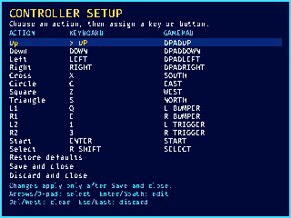

# Template controls menu (2026-10-16)

The shared Bevy starter includes physical keyboard/gamepad rebinding and a
reusable controls menu, independent of its demo. Gameplay continues to consume
logical `ControllerState` actions. Integration and settings paths are documented
in the [template README](../templates/psx-bevy/README.md#rebinding-and-the-example-controls-menu).



The editor keeps a draft until Save succeeds. Conflicts offer an explicit swap;
cancel, clear, restore defaults and discard preserve live mappings until then.
The versioned JSON store validates inputs, bounds reads to 64 KiB and stages
writes beside the destination before replacing it. A failed save keeps the draft
open. Invalid profiles stay untouched until an explicit save repairs them.

The shell samples mapped physical input before fixed ticks and retains short
taps. Menu capture clears physical, injected and latched inputs, suspends ticks
and waits for neutral physical input on close. Capture requires release before
listening, rejects simultaneous candidates and rearms when the selected gamepad
changes. Window focus loss discards the draft. Pending developer steps are
interrupted with an error; input/step requests are rejected while focus is held.

Validation commands (run in `templates/psx-bevy` unless indicated):

```sh
cargo test
cargo test --features dev-mcp
cargo build
cargo build --features dev-mcp
cargo fmt --check
cargo clippy --features dev-mcp --all-targets -- -D warnings
cargo test --features dev-mcp --test dev_mcp controls_menu -- --ignored --nocapture
# At the toolkit root:
cargo test -p psx template::tests
```

The rules tests exercise keyboard edits through persistence/reload, conflict
reject/swap, clearing, restoring custom defaults, discarding, gamepad-only
navigation through save and resumed gameplay, confirmation-button release gates,
ambiguous presses, gamepad reconnects, focus loss, malformed/oversized profiles
and failed-save recovery. The developer build also checks pending-step
interruption. Generator tests verify that every starter file is embedded.

The offscreen software-GPU test launches the actual game with `--controls`,
captures the screen, checks visible text and the unclipped bottom border, verifies MCP input/step errors and
confirms zero simulation ticks and no settings file creation. The screenshot
above was inspected: every row, footer and border fits the 320×240 canvas.
The first render clipped the bottom help line; reducing row/header spacing fixes
it without removing controls.

Scope: digital keys/buttons, including triggers, are rebindable; analog axes keep
their meaning and configurable deadzone. The example reserves Esc and, with
global shortcuts enabled, F1 and Start+Select. Gamepad tests use Bevy gamepad
components rather than physical hardware; the rendered check ran on Linux with a
software adapter. This does not claim physical-device or other-platform testing.

## Follow-up, 2026-10-17: legible labels and auto-advance

User report: the menu text was hard to read, and over a remote desktop session
the arrow keys arrived as other key codes, so rows could not be selected.

- **Labels.** Bevy's default vector font at 7.5–8.5 px with smoothing off broke
  up in the 320×240 canvas ("Up" read as "Dp", E like C). Labels now use
  `psx::font`, a 6×9 bitmap font taken from the public-domain X11 misc-fixed
  `6x9` glyphs (printable ASCII; anything else draws `?`). Each label is an
  `ImageNode` sized exactly to its image. An earlier attempt let the row height
  scale the image (9 px glyphs in 10 px rows, 13 px for the title), which
  widened glyphs unevenly. The one-line subtitle was dropped to fit the taller
  font; the rendered menu still ends above the bottom border.
- **Auto-advance.** A binding or confirmed swap moves the selection to the next
  action, and after Select to Save and close; the status says what comes next.
  Cancelling a capture stays on the row. A full layout can therefore be entered
  with Enter and the new keys only.

Validation: a new rules test binds all 14 actions with Enter plus a key each,
never touching the arrows, then saves with Enter and reloads the profile. Two
existing tests now reselect explicitly where they relied on the selection
staying put. Unit tests cover the font (multi-line size, unknown characters)
and that action labels and fixed hints fit their columns. The offscreen
software-GPU test passes, and its 320×240 capture was inspected at 3× nearest
scaling: every glyph is one canvas pixel wide.
